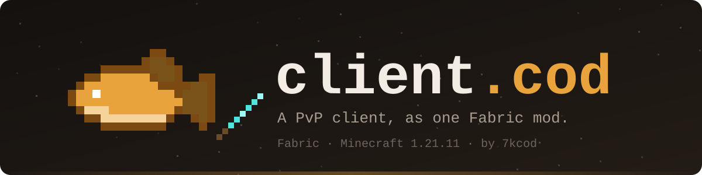

<p align="center">
  
</p>

<p align="center">
  
  
  
  
  
</p>

<p align="center">
  <b>A PvP client as one Fabric mod.</b><br>
  HUD you can drag anywhere, Lunar-style visuals, cosmetics, team pings, tiers, and
  <a href="../../../packs.cod">packs.cod</a> built right in.
</p>

<p align="center">
  <a href="#features">Features</a> ·
  <a href="#install">Install</a> ·
  <a href="#using-it">Using it</a> ·
  <a href="#building">Building</a> ·
  <a href="CHANGELOG.md">Changelog</a>
</p>

---

> The mod's in-game name is **pvp.cod**; this repo is **client.cod**. Same thing.

## Features

Every module can be switched on and off, and every setting can be changed: sliders, switches,
choices and a full colour picker. Visual modules show a **live view of your game** on their
settings page so you see the real effect while you tweak it.

### 🧭 HUD
Drag any box on the **Edit HUD** screen, scroll to resize, right-click for settings.
Boxes snap to the edges, the middle and each other.

| | | |
|---|---|---|
| Keystrokes (WASD, LMB/RMB + CPS, space) | FPS | CPS |
| Ping | Coordinates | Direction |
| Speed | Clock | Reach |
| Combo | Server | Armor status (number, % or both) |
| Potion effects | Totem counter | Item counter |
| Target HUD | Saturation | Memory |
| Biome | | |

### 🎨 Visual
| Module | What it does |
|---|---|
| Custom crosshair | 6 styles, size, gap, thickness, colour, outline, colour on players |
| Block outline | Lunar-style: colour, thickness, rainbow, see-through fill |
| Motion blur | Strength 1–5, HUD stays sharp |
| Item scaling | Shrink, grow and move held items |
| Low fire | Push the fire overlay down, or hide it |
| Clear water / Clear lava | Remove the fog so you can see |
| Side shield | Move the shield out of your view |
| Hitboxes | Your colours, plus colours for friends and your target |
| Zoom | Smooth zoom on C |
| Fullbright · No hurt cam | |
| Pumpkin blur | No pumpkin overlay |
| Boat map visibility | Keep your map up while rowing |
| Riptide shield fix | Hide your shield while spinning |
| Rescale aspect ratio | Stretched resolution (4:3, 5:4, 16:10, 1:1, custom) |
| Shulker box tooltips | See what's inside, as a grid |
| Clean HUD | Hide boss bars, scoreboard, effect icons |

### ⚔️ PvP
| Module | What it does |
|---|---|
| Team pings | Middle-click in survival to ping where you look. Your team gets a marker with your head, and the coords in chat |
| Tier tagger | Shows each player's MCTiers tier (e.g. `HT3`) in the game mode you pick |
| Friends | Coloured names, a heart, and no accidental hits |
| Totem pop counter | Who popped how many |
| Toggle sprint | |

### ✨ Cosmetic
| Module | What it does |
|---|---|
| Cosmetics | Halo, top hat, crown, cat ears, horns, shades, bandana, wings, cod hat |
| Cape swapper | 20 built-in cod capes, your own files, cloth (flowing) capes |
| Cape maker | Upload any picture, crop it, save it as a cape |
| Skin swapper | Wear any skin file, or anyone's skin just by typing their name |
| Cod icons | A cod next to names; admins can give players other icons |
| LabyMod + OptiFine capes | See other players' capes from those services |

### 🧩 Pages
**Edit HUD** · **Friends** · **Team** · **Wardrobe** · **Cape maker** · **pack.cod** · **Media** · **Admin** (key-locked: icons and tiers for players) · **Credits**

## Install

1. Install [Fabric Loader](https://fabricmc.net/use/) for **1.21.11** and [Fabric API](https://modrinth.com/mod/fabric-api).
2. Put `pvp-cod-<version>.jar` in your `mods` folder.
3. **Don't** also install the separate packs.cod jar; it's already inside. Two copies crash the game.

## Using it

| Key | Does |
|---|---|
| <kbd>Right Shift</kbd> | Open the menu (or click the cod top left on the title screen or pause menu) |
| <kbd>C</kbd> | Zoom |
| <kbd>Middle mouse</kbd> | Ping (survival) · <kbd>Sneak</kbd> + middle mouse on a player: add / remove friend |
| Edit HUD | Unbound by default |

Change keys in **Controls → pvp.cod**. Settings live in `config/pvpcod/pvpcod.properties`;
your skins and capes in `config/pvpcod/skins` and `config/pvpcod/capes`.

> Skins, capes and cosmetics only show on your own screen. Showing them to other players
> would need a server.

## Building

client.cod builds packs.cod into the same jar, straight from its source, so clone both side by side:

```
some-folder/
├── client.cod/
└── packs.cod/
```

```bash
git clone https://github.com/<you>/client.cod
git clone https://github.com/<you>/packs.cod
cd client.cod
./gradlew build          # Windows: gradlew.bat build
```

The jar ends up in `build/libs/`. Needs **Java 21**. If packs.cod is somewhere else, build with
`-PpackCodDir=path/to/packs.cod`.

`BUILD.bat` is a Windows helper for a Modrinth profile: it builds, removes old pvp.cod/pack.cod
jars from the profile's `mods` folder and copies the new one in (put the repo folder inside the profile).

### Project layout

```
src/main/java/dev/cod/pvpcod/
├── PvpCod.java          entry point, keys, HUD hooks
├── module/              every module and its settings
├── ui/                  menu, settings, HUD editor, wardrobe, admin, previews
├── mixin/               the game hooks (fire, fog, outline, capes, tooltips, ...)
├── Pings.java · Tiers.java · Wardrobe.java · OtherCapes.java · ...
src/main/java/dev/cod/packcod/ui/PvpTheme.java   shares packs.cod's look
```

## Changelog

See **[CHANGELOG.md](CHANGELOG.md)**. Every update gets a new `0.x` version.

## Credits

Made by **7kcod** 🇧🇾 (solo dev)

Built by 7kcod

Tier data from [MCTiers](https://mctiers.com). Cape images from LabyMod and OptiFine's public cape services.
Not affiliated with Mojang, Lunar Client, LabyMod, OptiFine or MCTiers.

## License

[MIT](LICENSE)
